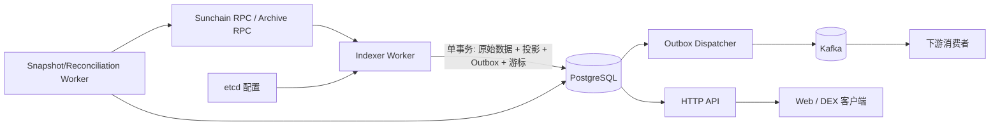

# Sunchain Indexer 详细设计

> 状态：设计提案。本文结合当前 Sunchain runtime 的 Substrate/SCALE 数据模型和 `bobychain_watcher_evm` 的 PostgreSQL、Kafka、etcd 服务模式编写。实现时以具体 runtime metadata 和 pallet event 定义为准。

## 1. 目标与设计原则

Indexer 是链上数据的可重放读模型，为区块浏览、交易查询及 DEX 行情、K 线、订单、成交、账户持仓和盈亏查询提供统一服务。链上 runtime 是资产、订单、持仓、指数价和资金费率的唯一权威；Indexer 不参与撮合和风险判断。

核心目标：

- 从 Sunchain 节点持续消费已 finalized 的区块，解码 header、extrinsic、runtime event 和 DEX 关键状态。
- 提供稳定的 HTTP 查询 API，以及供下游服务订阅的 Kafka 事件流。
- 通过 PostgreSQL 保存可查询的规范化数据和投影；通过 Kafka 分发外部事件；通过 etcd 管理运行配置。
- 支持从游标恢复、历史回填、幂等重放、运行时升级识别、积压监控及 finalized 数据修复。
- 采用整数/定点数处理金额和价格。对外 JSON 使用十进制字符串，避免 JavaScript 精度损失。

设计原则：

1. 仅将 finalized block 作为默认可见数据，避免把尚未确定的 fork 暴露为稳定业务事实。
2. 原始链数据、业务事件、派生投影分层存储；每个派生结果保留可追溯的 block/交易/事件来源。
3. 数据库提交、outbox 消息和同步游标在同一个 PostgreSQL 事务中提交；Kafka 投递通过 outbox 异步完成。
4. 所有投影均可从确定的起始高度重新构建；唯一约束和 upsert 保证重复处理不重复产生业务数据。
5. 节点 RPC 是数据入口；对 finalized 区块允许有限重试，不可把失败高度跳过并推进游标。

## 2. 当前链上数据依据与需要补齐的契约

当前代码中可见的 DEX 模块包括：

- `pallet-exchange-core`：`MarketCreated`、`TradeExecuted`、`OrderAccepted`、`OrderCancelled`、`OrderFilled`、`CollateralDeposited`、`CollateralWithdrawn`、`MarkPriceUpdated`、`FundingSettled`、`PositionLiquidated`、`AdlClosed` 等事件；核心 storage 包括 `Markets`、`Accounts`、`Positions`、`Orders`。
- `pallet-oracle`：`IndexPriceUpdated`、`QuotesSubmitted`、`ForcePriceOverride` 等事件；`PricePoints` 保存市场指数价和更新时间。
- `pallet-liquidation`：`Liquidated`、`AutoDeleveraged` 事件。
- 共享交易类型包含 `MarketId`、`PriceTicks`、`Lots`、`QuoteAmount`、`SignedQuote`；`Position.size_lots` 正数为多、负数为空，持仓包含 entry price、realized PnL 和 funding index。

因此链上数据源不是 EVM `eth_getLogs`，而是 Substrate block/extrinsic/event 与 runtime storage。Indexer 使用节点 JSON-RPC（至少 `chain_getBlockHash`、`chain_getHeader`、`chain_getBlock`、`chain_getFinalizedHead`、`state_getMetadata`、`state_getRuntimeVersion`、`state_getStorage`、`state_getKeysPaged`、`state_queryStorageAt`）；客户端按运行时 metadata 解码 SCALE。也可在节点进程内提供专用订阅适配器，但必须产出同一内部 Block/Extrinsic/Event 结构。

实现前应固定如下链契约，并作为版本化文档/fixture：

- genesis hash、chain spec 名称、runtime spec version，以及各 pallet 的 metadata 标识。
- DEX 事件字段和 SCALE 类型的 decode fixture；runtime 升级后旧 metadata 仍能解码历史区块。
- 事件索引中的 extrinsic phase、event index、extrinsic index 映射规则。
- 区块时间戳获取方式（Timestamp pallet `set` extrinsic 或 runtime API）；区块时间统一存 UTC 毫秒。
- 每个市场的小数位/单位规则。价格换算以 `Market.tick_size_quote`、`base_precision`、`lot_size_base` 为准，不得仅凭 `BTC-USD` 字符串推断。
- finalized head 的节点 RPC 行为、历史 state 可用性和 archive 节点策略。

建议后续在 runtime 提供稳定的 `IndexerRuntimeApi`，用于批量导出市场参数、账户/子账户、持仓与存储 schema version；首版可通过 metadata 与 storage key RPC 实现，但要将 storage key 生成和 SCALE decode 逻辑隔离成版本适配层。

## 3. 系统架构



建议首期交付单一 Rust 服务/镜像，提供 `all`、`indexer`、`api`、`migrate`、`rebuild` 命令模式；追赶和 API 可独立部署扩容。Rust async runtime、Substrate JSON-RPC 客户端、PostgreSQL + SeaORM、Kafka（Kafka 协议兼容 broker）、etcd 配置中心沿用参考项目方向。若当前仓库没有服务代码，可独立建立 `indexer/` workspace crate，避免将数据库与 HTTP 依赖引入 runtime/pallet。

模块建议：

```text
indexer/
  src/chain/       # Substrate RPC、metadata cache、SCALE 解码
  src/ingest/      # finalized block 拉取、批次调度、重试
  src/projector/  # DEX event projection、candle、account projection
  src/storage/     # SeaORM entities、repository、事务
  src/outbox/      # Kafka envelope、dispatcher、重试
  src/api/         # HTTP handlers、分页与响应 schema
  src/config/      # etcd/env/default 映射
  migration/       # PostgreSQL migrations
```

## 4. 索引流程与最终一致性

### 4.1 启动和恢复

启动时校验配置、连接 PG/etcd/Kafka/RPC，读取 genesis hash 和 runtime metadata，确认数据库记录的 chain identity 与节点一致。读取 `chain_sync_state`：若有游标从 `next_block_number` 恢复；无游标时按 `start_block_policy` 设置起点（`fixed:N`、`finalized`、`latest`）。生产环境默认从 finalized head 开始仅适用于全新实例；首次全历史建库必须显式给出固定起点或快照高度。

### 4.2 finalized 批次处理

每批按以下顺序执行：

1. 读取 finalized head hash/number，选择 `[next_block, min(next_block + batch_size - 1, finalized_head)]`。
2. 按高度取得 block hash、header、body、runtime version 和 metadata；一个范围可以并发 RPC，但必须按高度排序后处理。
3. 解码 extrinsics、System.Events；为每条事件记录 phase、event index、pallet、variant、SCALE 原始字节和尽可能完整的 JSON decode。
4. 由 projector 生成 exchange/oracle/liquidation 业务事件和读模型增量；对需要状态快照的投影在区块边界查询对应 storage。
5. 在同一 PG 事务内 upsert blocks、extrinsics、events、DEX rows、market/account projections、candles、outbox，并推进 `next_block_number` 与 last finalized hash。
6. 事务成功后继续下一批；Kafka dispatcher 独立发送 outbox。

发生 RPC、解码或数据库错误时不推进游标。已确认的 runtime 事件若新版本未知，保留 raw SCALE bytes、记录 decode 状态并将该 pallet/event 置为可观测的兼容错误；若未知事件可能影响关键 DEX 投影，则停止该批推进并告警，不能静默忽略后宣称投影完整。

### 4.3 重组和 finalized 约束

默认只索引 finalized 区块，正常情况下不需要常规回滚。每批仍验证父 hash 与前一游标的 `last_block_hash` 连续。若 finalized 链出现不连续（节点切换/错误 endpoint/极端共识故障），暂停推进并报警；管理员选择从共同祖先执行回滚重放。回滚删除或标记被替换区块关联数据、重建投影，并产生带有 `reverted` 状态/补偿版本的下游消息。若产品需要实时未确认数据，另建短暂 `best-chain` 层并定义显式回滚事件，不与 finalized API 混用。

## 5. PostgreSQL 数据模型

所有金额、价格、数量使用 `NUMERIC(39,0)` 或足够范围的整型存最小单位；SCALE `u128/i128` 使用 decimal string 转换，禁止 cast 到 `BIGINT`。时间为 `TIMESTAMPTZ`；地址/公钥存原始 bytea 并保存标准化 SS58 字符串（SS58 prefix 是展示配置，不作为身份键）。表间不加数据库外键，按参考项目做应用层关联与分区/清理。

| 表 | 关键字段与用途 | 唯一键/主要索引 |
|---|---|---|
| `chain_identity` | `genesis_hash`, `chain_name`, `ss58_prefix`, 首次识别时间 | genesis hash |
| `chain_block` | `block_number`, `block_hash`, `parent_hash`, `state_root`, `extrinsics_root`, `timestamp`, `spec_version`, `extrinsic_count`, `finalized` | `(chain_id, block_number)`、`(chain_id, block_hash)` |
| `chain_extrinsic` | `block_number/hash`, `extrinsic_index`, `extrinsic_hash`, signer、pallet/call、success、fee、dispatch error、raw SCALE | `(chain_id, block_hash, extrinsic_index)`、`extrinsic_hash` |
| `chain_event` | `block_number/hash`, `event_index`, `extrinsic_index`, `phase`, pallet、variant、decoded JSON、raw SCALE、decode status | `(chain_id, block_hash, event_index)`、`(chain_id, pallet, variant, block_number)` |
| `chain_sync_state` | `next_block_number`, `last_finalized_number/hash`, `runtime_spec_version`, `status`, `last_error`, `updated_at` | `chain_id` |
| `indexer_runtime_metadata` | `spec_version`, metadata hash/bytes, pallet index/name mapping, registration time | `(chain_id, spec_version)` |
| `dex_market` | `market_id`, base/quote code, tick/lot/base precision, margins, fee, status、当前 best bid/ask、净 OI、index/mark price、更新时间 | `(chain_id, market_id)` |
| `dex_trade` | trade key、市场、maker/taker、maker order id、taker client order id、side 可推导字段、price ticks、lots、base/quote qty、fee（若可取得）、block/time/event position | 唯一 `(chain_id, block_hash, event_index)`；市场时间索引 |
| `dex_order_event` | 接受、取消、成交、失效事件；owner/subaccount、market、client/order id、reason、剩余量（仅链上可得时填） | `(chain_id, block_hash, event_index)`；用户/市场时间索引 |
| `dex_position` | 当前账户/子账户/市场净 lots、entry ticks、realized pnl、funding index、最新快照高度、版本 | `(chain_id, account_id, subaccount_id, market_id)` |
| `dex_account` | collateral、reserved margin、status、open order count、last snapshot height | `(chain_id, account_id, subaccount_id)` |
| `dex_funding_event` | market、rate ppm、funding index、net OI、block/time/event | block event 唯一键；市场时间索引 |
| `dex_price_point` | market、source (`index`/`mark`)、price ticks、source count、block/time | `(chain_id, market_id, source, block_number)` |
| `dex_candle` | market、interval、open time、OHLC ticks、base volume、quote volume、trade count、first/last trade key、revision | `(chain_id, market_id, interval, open_time)` |
| `outbox_event` | event id/type/version, Kafka topic/key, payload JSON/bytes, status, retry count, next retry, error | `(event_id, topic)`；`(status, next_retry_at)` |
| `projection_checkpoint` | projector name/version、last applied block/hash、rebuild generation | `(chain_id, projector)` |

建议大数据表 `chain_event`、`chain_extrinsic`、`dex_trade`、`dex_order_event`、`dex_price_point` 按月或按 block range 分区；首期数据量低时可先普通表，保留在线 migration 路径。保留策略分层：原始 SCALE 与完整链事件按合规/成本策略长期保存；高频 candle 与投影在线保存；API 不直接返回任意原始二进制。

### 5.1 事件标识

`event_uid = genesis_hash:block_hash:event_index`，兼具链唯一性和 fork 区分。extrinsic ID 为 `genesis_hash:extrinsic_hash`。Kafka `event_id` 使用 `event_uid` 或其稳定 hash，保证消费者幂等；消息包含 `block_hash`、`block_number`、`event_index` 和 `finalized=true`。

## 6. DEX 投影及业务规则

### 6.1 事件解码与市场状态

`MarketCreated` 触发读取该高度的 `Markets[market_id]`，把 `tick_size_quote`、`lot_size_base`、`base_precision`、初始/维持保证金、费率、市场状态等完整配置 upsert 到 `dex_market`。参数更新类事件同理读取 state-at-block，而不是用事件不包含的默认值补字段。周期性刷新 best bid/ask、净 OI、资金指数和市场参数，避免某些只改 storage 而没有细粒度事件时投影永久陈旧。

### 6.2 成交与订单

`TradeExecuted` 是 K 线和成交量的主事实源。每条事件记录 maker/taker、市场、成交价格 ticks、lots、order/client id、block timestamp 和 event 顺序。base 数量：`lots * lot_size_base` 个 base atomic units；quote 数量按 runtime 的 tick 精度规则计算，所有中间值使用至少 256-bit 或 checked integer arithmetic，与 runtime `settlement.rs` 对齐。不能从事件直接得到的 taker side、fee 等字段应标为未知或通过前后账户/订单 state 补充，不能伪造。

`OrderAccepted`、`OrderCancelled`、`OrderFilled`、`OrdersInvalidatedUpTo` 等形成订单生命周期事件流。当前事件不足以无损重建完整订单簿（例如部分成交后的剩余量、链下 action 请求细节可能不完整），首期提供订单历史/活跃订单快照 API 时，应从 `Orders` storage 在 finalized 高度扫描并定期刷新；订单历史以链事件为准。不得把下单 RPC 被节点接收误认为订单已上链。

### 6.3 K 线、行情与市场统计

建议第一期 intervals：`1m, 5m, 15m, 1h, 4h, 1d`，统一 UTC 对齐。K 线由 finalized 成交按 `(block_number, event_index)` 顺序聚合：首笔为 open、末笔为 close、最高/最低为 high/low，volume 汇总 base atomic units、quote atomic units 和 trade count。空时间桶按需 API 生成“无成交”结果或返回空，不生成虚构 OHLC。

同一个区块内多笔成交按事件 index 排序。新成交 upsert 当前 candle；重复重放同一 event 不重复增加 volume，应由 event 唯一键和单事务投影保证。若做区块回滚或修复，受影响 candle 根据对应时间桶全部成交重算并增加 revision。

行情快照可包含 last trade、index price、mark price、best bid/ask、24h 高低、24h base/quote volume、open interest、funding rate。区分链上数据与计算项：指数价来自 `pallet-oracle::IndexPriceUpdated`/`PricePoints`，mark price 来自 `MarkPriceUpdated`/市场 state；last trade 来自 TradeExecuted；24h 统计从成交表滚动查询或维护有界聚合。API 响应同时返回 `as_of_block`、`as_of_time` 和来源类别。

### 6.4 持仓、已实现/未实现盈亏及资金费

首期对外持仓建议按 finalized state 快照为准：通过 storage key pager 枚举 `Positions`（或专用 runtime API）读取 `(account, subaccount, market)` 的 `Position`，并查询相同高度的 `Markets` 和 `Accounts`。只返回非零仓位，保留扁平仓位/清仓记录可选；同步 checkpoint 与 block hash 必须一致。事件流用于增量刷新已知活跃账户，定期全量/分片 reconcile 发现遗漏和纠正 drift。由于某些影响 position 的变更不一定一一对应单事件，单纯从 `TradeExecuted` 计算当前仓位不作为权威方式。

浮动盈亏需区分价格来源和计算口径：

- 价格输入：默认采用该 finalized 高度的 mark price；另提供 index price 与 last price 选项，但不得混称。
- `unrealized_pnl_quote = sign(size_lots) * floor(abs(size_lots) * abs(mark_ticks-entry_ticks) * tick_size_quote * lot_size_base / base_precision)`，符号由 size 与价格差的符号共同决定；与当前 `MarketPrecision::pnl` 的 checked integer 算法及舍入一致。实现应复用或抽取 `exchange-core` 纯数学函数形成共享 crate，避免 API 和 runtime 计算偏差。
- `realized_pnl` 直接读取链上 `Position.realized_pnl` 快照；展示累计已实现值和区间已实现值时区分定义。
- 未结算 funding 估值：`pending_funding = size_lots * (market.funding_index - position.funding_index)`，正负代表收/付方向须按 runtime `funding.rs` 注释和 settlement 实际符号验证。最终 total PnL 字段应显式拆分 `realized`、`unrealized`、`funding_pending`，不得仅给一个不透明的浮盈数字。
- `equity`、`maintenance_margin`、可用保证金等风险值应优先使用 runtime 同一高度的账户与 position state/API；如果由服务重算，必须复用完全一致的风险计算代码并标注 `calculated_by` 和版本。
- 每条持仓响应返回 `valuation_block`、`price_source`、`price_block`、`market_config_version`。若价格过期或缺失，返回 null + stale 状态，不能展示为 0 盈亏。

持仓 reconcile 的成本可能较高。按账号 key 前缀分页、以稳定的 finalized block hash 做快照；把进度保存到 `projection_checkpoint`，重启可续跑。建议 runtime 后续提供分页/聚合 Runtime API，避免外部服务直接依赖内部 storage key layout。

## 7. API 设计

版本前缀 `/api/v1`，JSON 响应统一包含 `data`、`meta`（`chain_id`、`genesis_hash`、`as_of_block`）；错误包含稳定 code/message。`u128/i128` 金额、价格和数量用字符串；block number、有限 enum 可为整数/字符串。分页使用游标 `(block_number,event_index)`，避免 offset 在大表上的成本。

首期端点建议：

| Method/Path | 说明 |
|---|---|
| `GET /healthz`, `/readyz`, `/metrics` | 存活、依赖就绪、Prometheus 指标 |
| `GET /blocks/{number_or_hash}` | 区块元数据、extrinsic/event 数 |
| `GET /extrinsics/{hash}` | extrinsic、签名者、dispatch 状态、关联事件 |
| `GET /events` | 按 block、account、pallet/variant 查询链事件 |
| `GET /markets`、`GET /markets/{id}` | 市场参数、状态及行情摘要 |
| `GET /markets/{id}/trades` | 成交历史，游标分页 |
| `GET /markets/{id}/candles?interval=1m&from=&to=` | OHLCV 历史 K 线 |
| `GET /markets/{id}/orderbook` | finalized 活跃订单簿快照（响应标明 snapshot block） |
| `GET /accounts/{address}/positions` | 子账户持仓及估值拆分 |
| `GET /accounts/{address}/orders`、`/trades` | 用户订单历史及成交历史 |
| `GET /accounts/{address}/balances` | collateral、占用保证金、账户状态 |
| `GET /markets/{id}/funding` | funding rate/index 历史 |

### 7.1 首期确认行情 API 范围

首期 Indexer 直接提供 **finalized/确认行情 API**，无需先建设独立行情服务。确认定义为 GRANDPA finalized；SFF fast-confirmed 只可作为另一个明确标注的风险层，不能提升为 finalized。API 包含：

- 市场列表/详情与 finalized 行情快照：last trade、index/mark price、best bid/ask、24h OHLC/成交量、open interest、funding 状态。
- finalized 成交历史和历史 K 线（`1m/5m/15m/1h/4h/1d`）。
- finalized 活跃订单簿快照，读取已 finalized block hash 对应的 `PriceLevels`/`Orders` state 或 Indexer 同高度投影；返回 `snapshot_block_number/hash`。
- 用户 finalized 持仓及 mark/index/last 三种估值口径和盈亏拆分；返回估值高度、价格来源、高度及 stale 标记。
- HTTP 查询端点，以及按请求量选择的 SSE/WebSocket 推送。推送只发布 finalized 修订，不承诺 best-chain 的亚秒级变化。

一致性要求：一次响应内的行情字段尽量对应同一个 finalized block hash；若 last trade、价格和订单簿投影高度不同，必须分别返回 `as_of` 元数据，不得伪装为原子快照。全部查询可由 PostgreSQL 投影重建，Kafka 是下游订阅方式。高并发缓存可后加，但缓存命中仍带投影高度和 finalized 标记。

明确不在首期 Indexer 行情 API 中提供：新块未 finalized 前的临时成交、临时盘口变化、可撤销消息或低延迟 best-chain feed。需要这些能力时，使用独立实时行情服务，详见 [实时行情服务设计](realtime-market-data-service-design.md)。

公共查询可匿名；管理/重建端点不暴露公网，配置 API Key 或内部网络访问控制。

## 8. Kafka 契约与 Outbox

采用 transactional outbox：链批事务内写 outbox，dispatcher 按状态投递 Kafka。Kafka 不纳入 PG 事务，消费端必须按 `event_id` 去重。首批 topic 建议：

- `sunchain.chain.block.finalized.v1`
- `sunchain.chain.extrinsic.v1`
- `sunchain.chain.event.v1`
- `sunchain.dex.trade.v1`
- `sunchain.dex.order-event.v1`
- `sunchain.dex.market-update.v1`
- `sunchain.dex.candle.v1`
- `sunchain.dex.position-update.v1`（需避免泄漏；建议私有 topic/账户级权限）

Envelope：`meta{event_id,event_type,event_version,chain_id,genesis_hash,block_number,block_hash,event_index,producer,occurred_at,finalized,trace_id,key}` + `payload`。Topic/schema 采用版本化 JSON Schema 或 Protobuf；新增字段向后兼容。partition key：成交/行情用 `market_id` 保序；用户私有事件用 account id；通用链事件用 block hash 或链 id，消费者按需选择吞吐/顺序保证。

Producer 要求 `acks=all`、幂等开启、合理压缩和发送超时。Outbox 状态 `pending/sent/dead_letter`，带指数退避与最大重试；成功发送后标记 sent。多 dispatcher 用数据库锁/租约领取批次；SeaORM 不支持 skip locked 所需能力时，将领取逻辑封装在受控 repository 实现中并明确使用兼容查询，不能让多个 worker 重复长时间抢占同一批。死信可重放，重放不改变 `event_id`。

## 9. 配置中心、启动和部署

配置优先级沿用参考工程：etcd typed config > 环境变量 > 默认值。etcd 连接通过 `APP_CONFIG_ETCD_ENDPOINTS`/`ETCD_ENDPOINTS` 与 `APP_CONFIG_ETCD_PREFIX`/`ETCD_PREFIX` 配置；敏感凭证用 Secret 管理，不写入普通配置值/日志。可热更新项（日志级别、批大小、API 限流）应有范围校验；连接地址、链 genesis 等身份配置重启生效。

关键配置：

```toml
[chain]
rpc_urls = ["http://sunchain-rpc:9944"]
archive_rpc_url = "http://sunchain-archive:9944"
expected_genesis_hash = "0x..."
start_block_policy = "fixed:0"
batch_size = 100
rpc_concurrency = 16
request_timeout_ms = 10000
retry_max = 8

[database]
url = "postgres://..."
max_connections = 20
min_connections = 2

[kafka]
brokers = "kafka:9092"
client_id = "sunchain-indexer"

[etcd]
prefix = "/sunchain/indexer/prod"

[projection]
snapshot_interval_blocks = 1000
reconcile_interval_secs = 300
enabled_candles = ["1m", "5m", "1h", "1d"]
```

配置范围、默认值最终应结合实际吞吐压测确定。启动顺序：加载 etcd/env 配置 → tracing/metrics → PG → migration → Kafka → 链 RPC/genesis 校验 → metadata 加载 → 恢复游标与投影 checkpoint → 启动 worker/API。`migrate` 独立运行；生产建议先执行 migration 再滚动部署。Indexer worker 按链单活或租约协调，API 可多实例；PG 使用连接池；Kafka topic 与 schema 在部署流程显式创建。

## 10. 故障处理、重建和运维

- RPC timeout/rate limit：指数退避、随机抖动、主备 endpoint；已 finalized 区块按高度重试，游标不跳跃。
- 节点 pruning：Indexer 必须连保留所需历史 state 的 archive 节点；仅抓 block body 的普通节点无法支持任意历史持仓 state 快照。
- runtime upgrade：记录每块 `spec_version`，缓存 metadata；按 spec version 选择 decoder。新版本未识别时保留原始数据并阻断受影响 projector。
- 数据库失败：批次事务 rollback；重新处理同一范围。批次尺寸支持调小，避免单事务过大。
- Kafka 失败：Indexer 仍可落库，outbox backlog 增长并告警；Kafka 恢复后继续投递。
- 投影漂移：通过 finalized storage snapshot reconcile；差异记录 before/after 与修复高度。修复不能直接改原始事实表。
- 重建：创建新 `projection_generation` 或影子表，从起始高度重放；校验行数、checkpoint 和关键汇总后原子切换读版本，避免线上 API 读到半成品。
- 数据库备份：定期 PG base backup/WAL；保存 genesis、metadata 和 migration 版本；演练恢复游标与 outbox。

## 11. 可观测性与安全

结构化日志必须带 `chain_id`、`genesis_hash`、`from_block`、`to_block`、`finalized_head`、`runtime_spec_version`、`event_count`、`duration_ms`、`projection_generation`。

核心指标：

- `sunchain_indexer_finalized_block`、`sunchain_node_finalized_block`、`sunchain_indexer_lag_blocks`
- `sunchain_indexer_batch_duration_seconds`、`sunchain_indexer_batch_errors_total`、`sunchain_indexer_decode_errors_total{pallet,event}`
- `sunchain_indexer_rpc_requests_total{method,status}`、`sunchain_indexer_projection_rows_total{type}`
- `sunchain_indexer_reconcile_mismatch_total{projection}`、`sunchain_outbox_pending_total`、`sunchain_kafka_send_total{status}`
- API 请求延迟、状态码、数据库连接池占用；避免把 account/address 作为高基数 metric label。

`/readyz` 至少验证 PG、同步状态、RPC identity 与 metadata；若 indexer 超过配置的最大滞后则可标记未就绪。所有管理端点需鉴权；禁止在日志中打印 API key、数据库 URL、用户签名原文。个人账户数据、私有 position Kafka topic 应按业务隐私要求控制访问与保留周期。

## 12. 交付阶段与验收标准

### 阶段 A：链数据基础

- 建立独立服务 crate、etcd 配置、PG migration、Substrate RPC 与 metadata decoder。
- finalized blocks、extrinsics、events 可从指定高度持续写入；同一区间重复执行无重复记录；断点恢复正确。
- runtime spec version 切换可保存 metadata，并能解码 fixture。

### 阶段 B：DEX 成交与行情

- 解析 exchange/oracle/liquidation 事件；市场参数从 state 正确补齐。
- 成交查询、行情快照、K 线 API 可用；相同链事件重放不会双计 volume。
- 对账结果与 finalized runtime storage 的价格/市场参数一致。

### 阶段 C：账户投影与盈亏

- 通过 finalized state snapshot 建立 collateral、position、funding projection；可断点续跑。
- 多空、加仓、减仓、翻仓、清仓、资金费、不同 lot/tick precision 的浮盈计算与 runtime 数学 fixture 一致。
- 价格缺失/过期时 API 明确返回不可估值状态；snapshot block 与价格 block 可审计。

### 阶段 D：Kafka/API 生产化

- PG 事务失败时游标、投影和 outbox 全部回滚；Kafka 暂停不影响链索引；恢复后消息最终送达。
- 消费端通过 event_id 幂等；消息包含 block/event 溯源字段和 schema version。
- 压测满足约定吞吐和查询延迟 SLO；告警覆盖 lag、解码错误、outbox backlog、reconcile drift。

建议在实现启动前定义目标：历史回填 blocks/sec、稳态 finalized lag 上限、API p95、数据保留周期和单链最大用户数。具体数字由团队部署规模决定，不在此文虚构。

## 13. 明确不属于 Indexer 的职责

- 不验证交易签名、不接受/替代 runtime 的订单撮合和清算结果。
- 不从未 finalized 的状态产生“最终”交易、K 线或盈亏结论。
- 不以 Kafka 作为唯一持久化源，不以 API 缓存作为链状态真相。
- 不在浮盈估值中将 oracle index、mark 和 last trade 混用。
- 不假定当前事件足以完整重建所有账户/订单状态；关键余额和持仓通过链上 state snapshot 或未来稳定 Runtime API 校正。

## 参考

- Sunchain：`pallets/exchange-core/src/lib.rs`、`pallets/exchange-core/src/types.rs`、`pallets/exchange-core/src/settlement.rs`、`pallets/exchange-core/src/funding.rs`、`pallets/oracle/src/lib.rs`、`pallets/oracle/src/types.rs`、`pallets/liquidation/src/lib.rs`。
- 技术与运行模式参考：`/home/alan/260909/DataMarket/git/bobychain_watcher_evm/doc/plan-01-foundation-and-bootstrap.md`、`doc/plan-02-schema-and-persistence.md`、`doc/plan-03-indexer-and-sync.md`、`doc/plan-04-outbox-and-kafka.md`。
