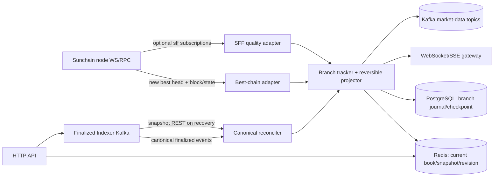

# Sunchain 实时行情服务详细设计

> 状态：可实施设计。服务提供 best-chain 临时行情和低延迟推送；finalized Indexer 仍是确认数据源。本文中所有 best-chain 状态均可撤销，不能用于资产结算、保证金判断或不可逆业务。

## 1. 目标与边界

实现一个可独立部署、扩缩容的 Rust 服务 `sunchain-market-data`，向 DEX 客户端提供：

- best-chain 上的新成交、最新市场快照、盘口变化和 ticker 推送。
- 低延迟 REST 快照与 WebSocket 实时订阅。
- finalized Indexer Kafka 数据作为最终校正流、历史 candle/成交基线和重启恢复来源。
- 在 best-chain 重组、SFF 降级或 Kafka/RPC 断连时输出明确回滚/重置消息，并恢复到确定的快照。

该服务不撮合、不提交订单、不决定市场状态、不管理余额/持仓，不负责历史全量回填。下单仍由客户端向 Sunchain 节点的 exchange RPC 提交。最终历史成交、K 线和确认行情以 Indexer API 为准。

状态分三类并显式暴露：

| 状态 | 来源 | 是否可撤销 | 用途 |
|---|---|---:|---|
| `best` | 节点当前 best chain 的 block import / new head | 是 | 最低延迟的 UI 行情 |
| `fast_confirmed` | 可选 SFF 证书视图 | 是，直到 GRANDPA finalized | 客户端风险分层提示；只作为标签/质量信号 |
| `finalized` | Indexer finalized Kafka + PG API | 否 | 确认历史、最终校正 |

SFF 不能替代 GRANDPA finality。任何 UI/API/Kafka 字段都不得把 `fast_confirmed` 标为 finalized。

## 2. 总体架构



推荐组件：Rust/Tokio、Substrate node WebSocket JSON-RPC、Redis（盘口和当前快照）、PostgreSQL（分支事件/恢复 checkpoint/审计）、Kafka（Indexer 输入和下游输出）、etcd（配置）。单进程可含 adapter/projector/API/gateway；规模增长后，按单写入 projector + 多 API gateway 拆分。该服务对单条链采用单 active projector，通过 PostgreSQL lease/election 或部署平台 singleton 保证单写入；API gateway 可多实例。

### 2.1 数据流

1. 启动加载配置，校验 `genesis_hash`，建立 WS RPC、Kafka、Redis、PG 连接。
2. 从 Indexer 取 finalized watermark 与必要的 market/orderbook snapshot；加载本地 checkpoint。
3. 订阅节点 `chain_subscribeNewHeads`。每收到 header，按 hash 拉取 block body 和该 hash 对应的 `System.Events` storage；不通过当前 best number 查询事件，避免发生竞态。
4. 按 `parent_hash` 将 block 放入 best-chain 分支图，识别新 head 的共同祖先和被替换分支。
5. 解码 `TradeExecuted`、`MarkPriceUpdated`、`IndexPriceUpdated`、订单簿相关事件；按 block/event 顺序生成可逆的投影变更。
6. 原子更新 Redis 当前 best book/ticker 和 branch revision；写入 PG journal/checkpoint；向 WS/SSE 及 Kafka 发布 update/retract/reorg 消息。
7. 消费 Indexer finalized topics；把已 finalized block 从临时 branch 确认为 canonical，校验事件一致，并清除 branch 可撤销标记。
8. 周期性校验节点 best/finalized head，遇到断流从 checkpoint hash 与 RPC canonical chain 追赶。

## 3. 节点接入与链数据解码

### 3.1 RPC 能力

首版客户端需支持：

- WebSocket pubsub `chain_subscribeNewHeads`、`chain_subscribeFinalizedHeads`；请求丢失后重新订阅并以 RPC 补齐高度缺口。
- `chain_getBlock(hash)` 或 `chain_getBlockHash(number)` + `chain_getBlock(hash)`，读取 block body。
- `state_getStorage(storage_key, block_hash)` 获取该块对应的 `System.Events`。
- `state_getMetadata(block_hash)`、`state_getRuntimeVersion(block_hash)`，按 `spec_version` 缓存 SCALE decoder。
- `state_getStorage(storage_key, block_hash)` 读取 `ExchangeCore::Markets`、`PriceLevels`、`Orders`。可选 `state_queryStorageAt` 只用作加速，不能替代按具体 block hash 可校验的读取。
- 可选 SFF RPC `sff_status`、`sff_fastConfirmedHead`、`sff_subscribeFastConfirmed`。订阅返回的 `revision`、`revocable`、`grandpaFinalized`、`consistency` 均需保留。SFF 不可用时服务仍可正常以 best/finalized 两层运行。

节点必须保留足够的近期 state。单节点 pruning 若无法查询历史 block state，需配置 archive/RPC history 节点；实时范围仅需最近若干十/百块，但启动和追赶窗口必须满足服务的 `branch_window_blocks`。

### 3.2 SCALE 与 runtime upgrade

- 按 block hash 读取对应 metadata/spec version，不能用当前最新 metadata 解码旧块。
- metadata cache key 为 `(genesis_hash, spec_version, metadata_hash)`，保存于 PG/磁盘 cache。
- 每个 event 解码为 `{pallet, variant, fields, phase, event_index}`，同时保留原始 SCALE 字节和 block hash。
- 未知事件保留并忽略普通行情投影；未知 `ExchangeCore` 成交/盘口关键事件则进入 `degraded`，暂停发布完整盘口增量并触发快照重建。
- 时间戳由该 block 执行 Timestamp pallet `set` 的值确定；未找到时以父 block 时间加平均间隔仅作为临时展示时间，并标注 `timestamp_quality=estimated`。对同块的事件都按 block number/event index 排序，不能只依赖墙钟。

### 3.3 盘口读取策略

当前 runtime 具有 `Markets.best_bid/best_ask`、有序链式 `PriceLevels`（每个 level 有 `prev_price/next_price`、`head/tail`、总 lots/order count）和 `Orders` FIFO linked list。`PriceLevels` 的 storage key 使用 Blake2 concat，原始 storage key 顺序不是价格排序，因此不能通过遍历 storage key 直接构造正确盘口。

快照读取流程：

1. 对指定 block hash 读取 `Markets[market_id]`，拿到 `best_bid`、`best_ask`。
2. 买盘从 best bid 沿 `next_price` 前进（价格递减），卖盘从 best ask 沿 `next_price` 前进（价格递增）；对每个 `PriceLevels[(market, side, price)]` 读取 level。
3. 首版返回每档汇总 `total_lots`、`order_count`；若产品要展示单笔挂单队列，再按 level 的 `head` 和 `Order.next_order` 读取，限制最大深度和每档订单数。
4. 上限由配置 `book_depth` 控制，绝不无界遍历；校验递增/递减关系、prev/next 互指和 guard 上限，任何不变量失败则丢弃快照并进入 degraded/rebuild。
5. 所有 read 都绑定同一 `block_hash`。不能混合不同高度的 Market 和 PriceLevels 状态。

因为首版没有成熟的 orderbook storage change RPC，安全实现是每个新 best block 按事件影响市场：对有交易/下单/撤单事件的 market，在该 block hash 读取 top-N book snapshot 并 diff；未影响市场的 book 不查。该方式最准确但 RPC 成本随活跃市场数增大。压测后可升级为 runtime 自定义 `market_data_orderbook(market, depth)` Runtime API 或节点原生订阅，将单块 top-N 快照批量返回。不要自行从不完整事件猜测剩余订单量。

## 4. Best-chain 分支和可逆投影

### 4.1 内存/持久化数据结构

```text
BlockNode {
  hash, parent_hash, number, timestamp, spec_version,
  status: best | fast_confirmed | finalized | orphaned,
  events[], affected_markets[], applied_revision
}
BranchState {
  best_hash, best_number, finalized_hash, finalized_number,
  common_ancestor, revision, degraded_reason
}
```

PG `market_branch_block` 保留窗口内 header、父 hash、状态、接收时间；`market_branch_event` 保存已解码的 market event 和 event uid；`market_branch_mutation` 保存应用于 Redis 投影的 before/after 或可重算操作；`market_checkpoint` 保存 finalized snapshot hash 和 projector version。Redis key 需包含 genesis hash 和 market ID，例如 `md:{genesis}:{market}:book`、`ticker`、`branch_revision`。

每个 update/retract 事件 ID 固定为 `{genesis_hash}:{block_hash}:{event_index}:{projection_version}`。WebSocket 客户端通过 monotonic `revision` 和 `event_id` 去重。

### 4.2 处理新 head 与重组

- 验证新 header 的 hash、number、parent hash。
- 若 `parent_hash == current_best_hash`：正常延伸，追加 block 并应用投影。
- 若 parent 在保存的 branch DAG：找到共同祖先。先按反向顺序撤销 current best 到祖先之后的 block mutations，再正向应用新分支至新 head。
- 若 parent 不在 DAG：向 RPC 从新 head 向前取 header，直到命中已知 hash 或达到窗口上限；若仍找不到，清空临时投影，读取新 best block 的全量 market/orderbook snapshot，发布 `snapshot_reset`，进入 degraded 直到重建完成。
- 重组消息先发送 `reorg_begin{from_hash, ancestor_hash, old_tip, new_tip, revision}`，随后逐个 retract orphan event，再发送新链 updates，最后 `reorg_end`。API 同一 revision 下不暴露中间半成品；Redis 更新通过 Lua/transaction 或 staging key 原子切换。
- orphan block/event 保留审计 TTL，不物理删除；确认不会再被引用后过期清理。

不可逆交易使用前必须等 finalized。best-chain 渠道只适合 UI“实时预览”；客户端应能撤回界面上已显示的成交与盘口变化。

### 4.3 finalized 对账

消费 Indexer Kafka 的 finalized block、trade、market update。按 `block_number/hash` 与 branch journal 对齐：

- 完全匹配：将对应临时 block 标为 finalized，修正数据质量标签，更新 finalized watermark。
- Indexer 消息到达时本服务尚未看到该 block：从 finalized RPC 补块并应用，再将当前 best branch 重算。
- 同高度 hash 不匹配：finalized hash 是权威；回滚与其冲突的分支，刷新该高度之后的 state snapshot，发 `reorg`/`snapshot_reset`。
- 收到 finalized 消息的顺序不连续：持久化待处理消息并补齐中间高度；不得越过 gap 推进 finalized watermark。
- Kafka 重投：按 finalized block hash 和 event ID 幂等。

Kafka topic 初步依赖 Indexer 设计：`sunchain.chain.block.finalized.v1`、`sunchain.dex.trade.v1`、`sunchain.dex.market-update.v1`。Indexer 事件 envelope 至少需含 `genesis_hash, block_number, block_hash, parent_hash, event_index, event_id, finalized`。若现有 envelope 未含 parent hash，实时服务消费 block topic 后应调用 RPC 校验，建议同时将 parent hash 纳入 Indexer 消息 schema。

## 5. 行情投影

### 5.1 市场快照

每个 market 维护：

```json
{
  "market_id": 0,
  "last_trade": {"price_ticks":"60000", "lots":"2", "block_hash":"0x...", "event_index":12},
  "index_price_ticks":"59995",
  "mark_price_ticks":"60002",
  "best_bid_ticks":"59990",
  "best_ask_ticks":"60010",
  "bid_depth":[{"price_ticks":"59990","total_lots":"12","order_count":3}],
  "ask_depth":[],
  "volume_24h_base":"...",
  "volume_24h_quote":"...",
  "high_24h_ticks":"...",
  "low_24h_ticks":"...",
  "funding_rate_ppm":0,
  "open_interest_lots":"...",
  "as_of":{"best_number":100,"best_hash":"0x...","finalized_number":96,"finalized_hash":"0x...","quality":"best","revocable":true,"revision":41}
}
```

所有 `u128/i128` 和 ticks/lots 对外用十进制字符串。best snapshot 与 finalized reference 分列，防止 consumer 混淆。

### 5.2 事件归因

- 成交：`TradeExecuted` 生成暂时性 trade update。唯一键包含 block hash + event index；价格/数量使用链上 ticks/lots 和市场精度。不完整的 fee/side 不推断。
- 指数价：`pallet-oracle::IndexPriceUpdated`。
- 标记价：`ExchangeCore::MarkPriceUpdated`。
- 订单簿：受影响市场按该 block state 读取 top-N snapshot，然后发布 `book_delta` 或 snapshot reset。首版安全优先，未实现可靠的增量差分前只发布完整 top-N snapshot。
- Funding/OI/市场状态：从对应事件与同 hash 的 `Markets` state 读取；更新后标注 block 来源。
- 24h ticker：从 finalized Indexer 交易历史基线加载最近 24h，再把 best-branch trades 做可逆 overlay；reorg 时撤销 overlay。跨 finalized 边界时避免重复计量（event ID 去重）。
- 历史 candle：由 Indexer 查询；实时当前 candle 可由 finalized 最新 candle + best 分支成交 overlay 计算，出现 reorg 时从该时间桶的 finalized trades 和存活 branch trades 重算。只推当前未封闭桶；封闭桶等待 Indexer finalized candle。

## 6. 对外接口

### 6.1 HTTP API

REST base `/api/v1`：

| Path | 行为 |
|---|---|
| `GET /healthz` | 进程活性 |
| `GET /readyz` | RPC/Redis/PG 可用且已恢复基础快照；Kafka optional/degraded 单独显示 |
| `GET /markets` | 当前市场行情摘要，含 best/finalized watermark |
| `GET /markets/{id}/ticker` | 单市场实时快照，`quality=best` 或 `finalized` 可选 |
| `GET /markets/{id}/orderbook?depth=20&quality=best` | 当前 top-N 快照、snapshot hash、revision、revocable |
| `GET /markets/{id}/trades?limit=100&cursor=` | 最近 best-chain 临时成交，携带 event ID 和 block hash |
| `GET /markets/{id}/candles/current?interval=1m` | 当前未封闭 candle overlay |
| `GET /status` | 节点、Indexer、Kafka watermarks、分支深度、degraded reason、SFF 状态 |

若请求 `quality=finalized`，可代理 Indexer API 或从 finalized snapshot cache 返回；高质量历史 K 线仍由 Indexer 提供。请求参数限制深度/页长；对外错误区分 `stale_data`、`rebuilding`、`unknown_market`、`temporarily_unavailable`。

### 6.2 WebSocket 协议

端点 `/ws/v1/market-data`。客户端先发：

```json
{"op":"subscribe","channels":[
  {"name":"ticker","market_id":0,"quality":"best"},
  {"name":"orderbook","market_id":0,"depth":20,"quality":"best"},
  {"name":"trades","market_id":0,"quality":"best"}
]}
```

服务先发同步 snapshot，再发增量：

```json
{"type":"snapshot","channel":"orderbook","market_id":0,"revision":41,
 "block_hash":"0x...","block_number":100,"quality":"best","revocable":true,
 "bids":[],"asks":[]}
```

```json
{"type":"update","channel":"trade","event_id":"...","revision":42,
 "block_hash":"0x...","block_number":101,"event_index":8,"quality":"best","revocable":true,
 "trade":{"price_ticks":"60000","lots":"1"}}
```

必需控制消息：

- `hello{protocol_version, genesis_hash, best_head, finalized_head}`
- `snapshot`（新订阅、重连或 revision gap 后必须全量重发）
- `update`（含 revision/event ID/block hash）
- `retract{event_id,block_hash,revision,reason:"reorg"}`
- `reorg_begin` / `reorg_end`
- `finalized{block_hash,block_number,event_ids[]}`
- `snapshot_reset{reason,revision}`
- `heartbeat{server_time,best_head,finalized_head}`
- `error{code,message,retryable}`

客户端带 `resume_after_revision` 重连。若 revision 超出 ring buffer 保留窗口，服务回 `snapshot_reset` 并给全量快照，不能静默跳过。队列满时断开慢消费者并给可重连错误；不可让慢客户端阻塞 projector。

SSE 可作为只读简化接口，语义与 WS update/retract 一致，Last-Event-ID 用 revision/event id。

### 6.3 Kafka 输出 topic

实时服务输出临时数据时，topic 名明确带 `provisional`：

- `sunchain.market.provisional.ticker.v1`
- `sunchain.market.provisional.orderbook.v1`
- `sunchain.market.provisional.trade.v1`
- `sunchain.market.provisional.control.v1`（retract/reorg/finalized/reset）

Envelope 固定为 `meta{event_id,event_type,event_version,producer,genesis_hash,market_id,block_number,block_hash,event_index,revision,quality,revocable,occurred_at}` + `payload`。key 使用 market_id，保证同市场 partition 顺序。Producer 用幂等、`acks=all`；但消费端仍需按 ID 去重，并必须处理 retract。此 topic 不得与 Indexer 的 finalized topics 共用，避免消费者误将临时事实当成永久事实。

WS 和 Kafka 由同一已提交 revision 发布。由于 Redis/PG/Kafka 无跨系统事务，使用服务自己的 delivery outbox：PG 写入 projection journal + `market_outbox`；提交后 fanout worker 发 Redis 更新/WS/Kafka 并记录状态。重启时按 PG checkpoint 恢复 Redis，再重发 outbox；客户端按 ID/revision 去重。对实时体验，允许 WS 相对链头数百毫秒延迟，不允许先广播未持久化且无法恢复的消息。

## 7. 存储、checkpoint 与恢复

PostgreSQL 表（建议）：

- `market_service_state(genesis_hash PK, best_hash, best_number, finalized_hash, finalized_number, revision, projector_version, degraded_reason, updated_at)`。
- `market_branch_block(genesis_hash, block_hash PK, parent_hash, block_number, timestamp, spec_version, status, imported_at)`；索引 `(genesis_hash, block_number)`。
- `market_branch_event(event_id PK, block_hash, block_number, market_id, event_index, event_type, payload_json, raw_scale, status)`；索引 `(market_id, block_number,event_index)`。
- `market_book_snapshot(genesis_hash, market_id, block_hash, quality, revision, bids_json, asks_json, created_at)`；仅保留窗口内快照。
- `market_projection_checkpoint(genesis_hash, market_id, block_hash, revision, projection_version, state_hash)`。
- `market_outbox(event_id, topic, key, payload, status, retry_count, next_retry_at, last_error)`，唯一 `(event_id,topic)`。

Redis 是可重建 cache，PG journal 是恢复来源，Indexer finalized data 是 canonical business source，节点 RPC 是 best-chain source。

启动恢复：

1. 载入 PG `market_service_state` 和保留的 branch DAG。
2. 校验 checkpoint block hash 是否仍是节点祖先；通过 `chain_getBlockHash(number)`/header ancestor 比对。
3. 若仍为祖先，恢复 Redis snapshot 并从 checkpoint 后补块至当前 best；若不再 canonical，计算共同祖先并回滚；若超过保留窗口，使用 Indexer finalized snapshot + 节点当前 best state 重建并发 reset。
4. 处理 PG 未发送 `market_outbox`；先恢复投影再补发，按 revision 输出。
5. Kafka finalized consumer 从保存 offset 重放；消费 offset 与 DB 更新需通过 inbox 去重表/事务消息记录，不能仅依赖自动提交 offset。

保留窗口配置 `branch_window_blocks` 默认 256（需结合出块频率、SFF 视窗和 RPC 能力确定），`branch_retention_secs` 默认 3600。超过窗口自动进入 full snapshot rebuild，不无限占内存。链服务停机后补块若大于 `max_catchup_blocks`，拒绝 ready 并后台分批恢复。

## 8. 一致性、降级与故障矩阵

| 故障 | 行为 |
|---|---|
| WS 断连 | 标记 `rpc_connected=false`；停止生成 best 更新；重连后由 best header 和 checkpoint 补齐；gap 超窗则全量 reset |
| RPC 节点切换且 genesis 不同 | 立刻拒绝新节点，保留原状态但 ready=false，记录 identity mismatch |
| 父 hash 不匹配 | 分支 ancestor 搜索、rollback/reapply；找不到祖先就重建快照 |
| SCALE 解码失败（行情关键事件） | degraded、停止相关市场 delta、发布状态告警；获取 state snapshot + 更新 metadata 后恢复 |
| Indexer Kafka lag | best 层继续服务但显示 finalized watermark stale；超过阈值 readiness/quality 降级；最终以 Indexer 校正 |
| Redis 故障 | 无法提供快照/WS；由 PG checkpoint 重建 Redis；API 返回可重试错误 |
| PG 故障 | 停止应用新 revision（避免不可恢复广播）；best RPC queue 有界缓存，恢复后补齐 |
| Kafka 输出故障 | 本地 outbox 累积并告警；WS 可继续从已提交投影推送，outbox 达上限则暂停新投影或按容量策略降级 |
| SFF degraded/conflicting | 仅移除 fast-confirmed quality 标记；best 和 finalized 路径继续；记录 SFF status/revision，不把冲突链当 finalized |
| runtime upgrade 未兼容 | 缓存新 metadata 并试解；关键事件未知则 market degraded；升级 decoder 后重放受影响 branch |

单独暴露 `best_head_number/hash`、`finalized_head_number/hash`、`indexer_finalized_number`、`branch_lag`、`kafka_lag` 和每市场 `snapshot_age_ms`。前端应根据状态决定显示实时标签/风险提示。

## 9. 安全、性能与运维

- WebSocket 最大订阅市场数、最大 book depth、每 IP 连接数、消息速率、frame size 均配置限额。
- 公开行情不包括账户级订单、持仓或签名数据；不使用用户地址作为高基数 metric label。
- RPC 凭证、Kafka SASL、PG 密码只从 Secret/安全配置注入；日志屏蔽 credential。
- 订单簿快照并发受限，优先批量/Runtime API。按活跃 market 合并 RPC 请求；缓存 block-scoped storage reads。
- 用 `revision`/event id 协议保证重连和重复消息安全；客户端显示时间不能代替 block 顺序。
- 行情快照显示 price ticks 和市场 precision；格式化后的 human price 仅为附加字段。

Prometheus 指标：

- `market_data_best_head`、`market_data_finalized_head`、`market_data_indexer_finalized_head`、`market_data_branch_depth`。
- `market_data_rpc_requests_total{method,status}`、`market_data_rpc_latency_seconds{method}`、`market_data_decode_failures_total{spec_version,pallet,event}`。
- `market_data_reorg_total{depth}`、`market_data_snapshot_rebuild_total{reason}`、`market_data_snapshot_age_seconds{market_id}`。
- `market_data_ws_clients`、`market_data_ws_dropped_clients_total{reason}`、`market_data_ws_messages_total{type}`。
- `market_data_outbox_pending`、`market_data_kafka_send_total{status}`、`market_data_finalized_lag_blocks`。

运行模式：`all`、`projector`、`api`、`migrate`、`rebuild --from-hash <hash>`。启动顺序为 config/etcd → tracing/metrics → PG migration → Redis/Kafka → node genesis/metadata 校验 → finalized baseline → PG checkpoint/branch recovery → RPC subscriptions → ready。配置变更中，连接地址/genesis/projector schema 重启生效；限流、日志级别可热更新。

## 10. 配置样例

```toml
[chain]
ws_url = "ws://sunchain-node:9944"
archive_ws_url = "ws://sunchain-archive:9944"
expected_genesis_hash = "0x..."
rpc_timeout_ms = 3000
rpc_max_concurrency = 32
branch_window_blocks = 256
max_catchup_blocks = 5000

[indexer]
bootstrap_http_url = "http://sunchain-indexer:8080"
finalized_kafka_brokers = "kafka:9092"
finalized_topics = ["sunchain.chain.block.finalized.v1", "sunchain.dex.trade.v1", "sunchain.dex.market-update.v1"]
max_finalized_lag_blocks = 20

[storage]
postgres_url = "postgres://..."
redis_url = "redis://redis:6379"

[market_data]
http_bind = "0.0.0.0:8081"
ws_bind = "0.0.0.0:8082"
book_depth = 20
max_book_depth = 100
snapshot_every_blocks = 16
branch_retention_secs = 3600
max_ws_connections = 20000
max_subscriptions_per_connection = 100
ws_ring_buffer_revisions = 4096

[kafka_output]
brokers = "kafka:9092"
provisional_topic_prefix = "sunchain.market.provisional"
```

配置读取沿用 etcd > environment > default；etcd key prefix 如 `/sunchain/market-data/prod`。未配置 SFF RPC 时关闭 fast-confirmed 标签。

## 11. 实现模块与状态机

```text
src/
  chain/rpc.rs                 # jsonrpsee client、订阅、重连
  chain/metadata.rs            # spec-version metadata cache
  chain/decode.rs              # block/event SCALE decode
  chain/orderbook_snapshot.rs  # Markets/PriceLevels/Orders 绑定 hash 读取
  branch/dag.rs                # block DAG、ancestor/common-ancestor search
  branch/reorg.rs              # rollback/reapply planning
  projector/market.rs          # ticker/trade/price/book projection
  projector/candle.rs          # current candle overlay
  canonical/consumer.rs        # Indexer Kafka finalized input
  storage/                    # SeaORM models/repos/transaction
  cache/redis.rs               # atomic snapshot/revision swap
  delivery/outbox.rs           # Kafka/WS delivery and replay
  api/http.rs                  # REST
  api/ws.rs                    # WS/SSE protocol
  config.rs / metrics.rs / main.rs
```

核心 projector 状态机：

```text
BOOTSTRAP -> RECOVERING -> LIVE
                         |  \
                         |   \ decode/invariant/storage failure
                         v    v
                      REORG  DEGRADED
                        |       |
                        +---> REBUILDING
                                  |
                                  +--snapshot verified--> LIVE
```

只有 `LIVE` 发布 best updates；`DEGRADED/REBUILDING` 仍可提供最后一份快照，但标 `stale=true` 并禁止发送貌似连续的增量。`REORG` 期间使用原子 revision 更新，完成后恢复 LIVE。

## 12. 编码落地顺序

1. **契约 fixture**：从运行时生成/保存市场、PriceLevel、Order、ExchangeCore/Oracle event metadata SCALE fixture；验证当前 spec version 和 storage key builder。
2. **RPC/metadata adapter**：实现节点 WS 重连、new head、block/state-at-hash 读取、runtime metadata cache 和 genesis 校验。
3. **盘口快照器**：按 Markets best bid/ask + linked PriceLevels 读取 top-N，校验链表不变量；提供只读内部接口。
4. **PG journal + branch tracker**：持久化 header/event/checkpoint，完成 parent DAG、gap catchup、共同祖先搜索。
5. **可逆 projector**：实现 best trades/price updates/book snapshot 与 reorg rollback；所有记录以 block hash/event index 唯一化。
6. **Indexer finalized consumer**：Kafka inbox 幂等、offset 恢复、finalized reconciliation、冲突回滚。
7. **Redis atomic cache**：revision 化 ticker/book snapshots 和快照读取；PG/节点数据重建验证。
8. **WS/HTTP + outbox**：snapshot/update/retract/reorg/reset 协议、慢客户端治理、REST status/ticker/orderbook。
9. **运行配置、metrics、health、部署**：etcd、限流、告警、单 active projector lease、优雅停机。
10. **灰度上线**：先 shadow mode 不推送，仅比对 best snapshot 与 finalized Indexer；再启用 best REST；最后开启 WS/Kafka provisional 输出。

## 13. 验收条目

- 新 head 延伸时推送单调 revision 的 ticker/trade/book 更新，均有 hash、height、quality 和 revocable 标记。
- 模拟同高度 fork 时，旧分支的每条已发送交易均收到 retract，盘口回到共同祖先并反映新分支；不得双计 volume。
- 服务断开若干块后可补齐；超出保留窗口时返回 reset 并由快照恢复。
- 节点 runtime spec version 更新后能按对应 metadata 解码；关键事件解码失败会 degraded 而不是静默继续。
- finalized Indexer Kafka 重投、晚到、缺块情况下，最终 snapshot 与 Indexer finalized API 同高度数据一致。
- SFF `aheadOfFinality`、`conflicting`、`degraded` 场景仅影响 fast-confirmed 质量状态，不影响 GRANDPA finalized 认定。
- Redis/PG/Kafka 任一故障按故障矩阵降级；重启能恢复同一 revision 状态，不丢 retract/outbox。
- WebSocket 客户端 revision gap、慢消费、断线重连均收到 reset/snapshot，而非静默漏消息。
- 对一个市场进行 N 个 block 的连续盘口查询，RPC 并发、每块调用数和 top-N 深度有上限并记录 metrics。

## 14. 明确假设与待验证项

- 当前 `pallet-exchange-core` 订单簿储存使用 `Markets.best_bid/best_ask`、`PriceLevels` linked levels 和 `Orders` linked FIFO；实现需以当前 runtime metadata 为准。
- 节点 `chain_subscribeNewHeads` 的订阅头是本节点当前 best-chain 导入头；服务通过 parent hash 和 RPC 验证，不依赖通知顺序推断 canonicality。
- SFF RPC 在当前节点作为可选质量信息，且其代码明确标注可撤销并由 GRANDPA 权威确认。
- Indexer Kafka schema 需要包含 parent hash 和 finalized block hash；若未包含，服务补 RPC 查询并在后续 schema 版本升级。
- 活跃市场数量、出块频率、目标行情延迟、盘口深度和最大客户端并发须在压测前由部署方确定；文中默认值仅为初始配置建议。
